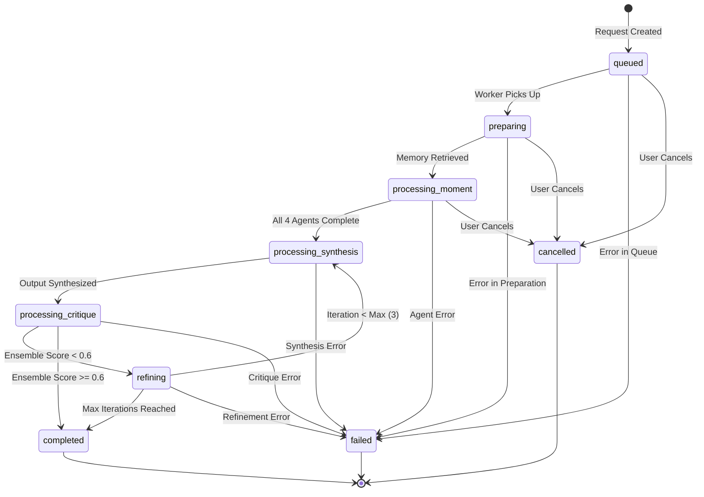
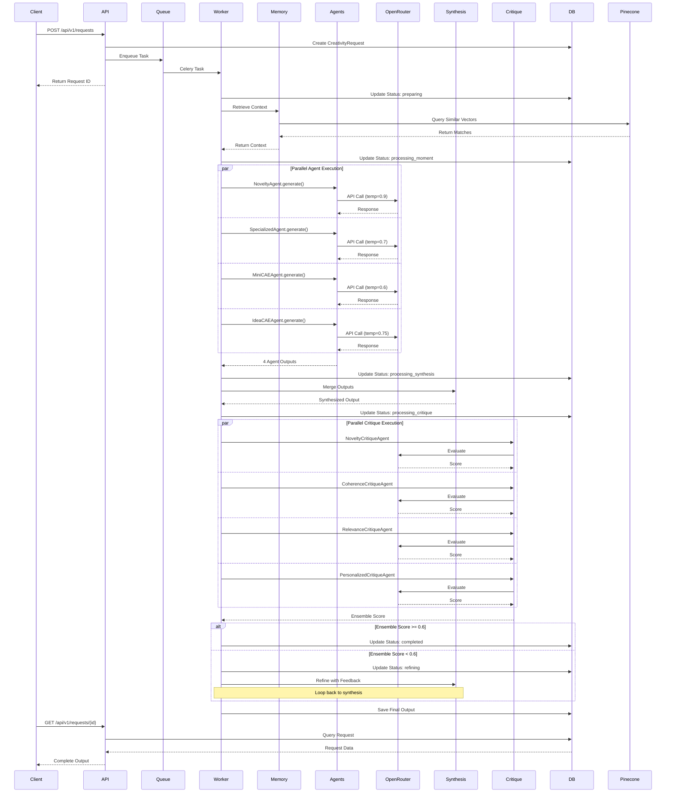
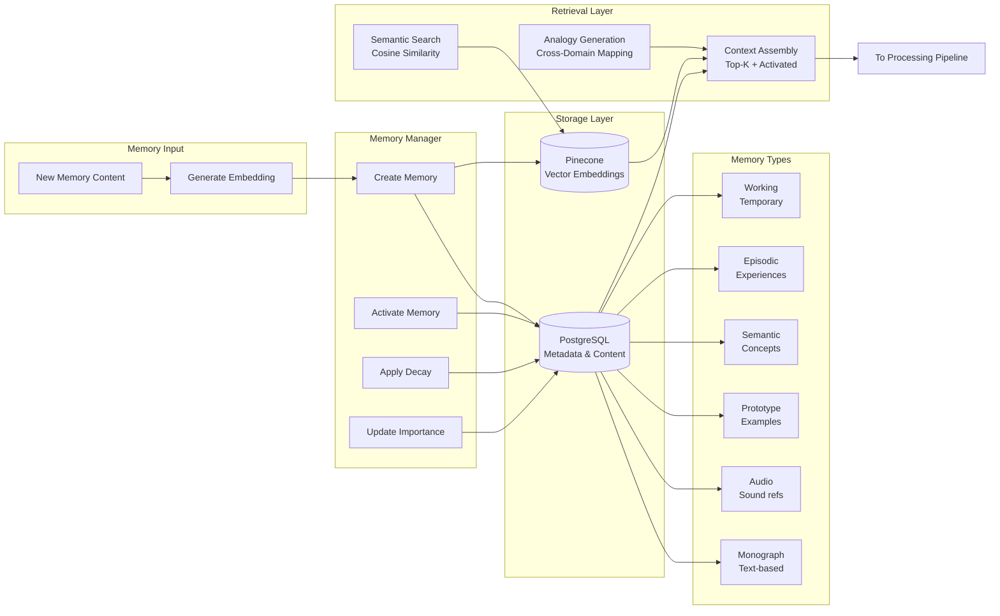
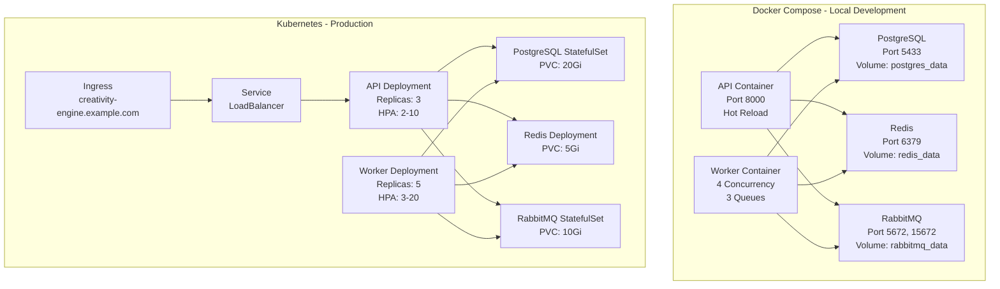

# Creativity Engine API Architecture

## Complete System Diagram

```mermaid
graph TB
    subgraph "Client Layer"
        CLIENT[Client Applications]
        WS_CLIENT[WebSocket Client]
    end

    subgraph "API Layer - FastAPI"
        ROOT["/  - Root"]
        DOCS["/docs - Swagger UI"]

        subgraph "Health Endpoints"
            HEALTH["/health - Basic Health"]
            HEALTH_READY["/health/ready - Readiness"]
            HEALTH_LIVE["/health/live - Liveness"]
        end

        subgraph "Request Endpoints"
            POST_REQ["POST /api/v1/requests<br/>Create Request"]
            GET_REQ["GET /api/v1/requests/{id}<br/>Get Request"]
            LIST_REQ["GET /api/v1/requests<br/>List Requests"]
            DEL_REQ["DELETE /api/v1/requests/{id}<br/>Cancel Request"]
        end

        subgraph "Status Endpoints"
            GET_STATUS["GET /api/v1/status/{id}<br/>Get Status"]
            WS_STATUS["WS /api/v1/ws/status/{id}<br/>Real-time Updates"]
        end

        subgraph "Feedback Endpoints"
            POST_FEEDBACK["POST /api/v1/feedback<br/>Submit Feedback"]
            GET_FEEDBACK["GET /api/v1/feedback/{id}<br/>Get Feedback"]
            PUT_FEEDBACK["PUT /api/v1/feedback/{id}<br/>Update Feedback"]
        end
    end

    subgraph "Task Queue Layer"
        QUEUE[Queue Manager<br/>src/processing/queue.py]
        CELERY[Celery App<br/>src/processing/celery_app.py]
        WORKER[Celery Worker<br/>Async Task Execution]
        RABBITMQ[(RabbitMQ<br/>Message Broker)]
    end

    subgraph "Processing Pipeline"
        PIPELINE[Pipeline Orchestrator<br/>src/processing/pipeline.py]

        subgraph "Pipeline Stages"
            STAGE1[1. Preparation<br/>Status: preparing]
            STAGE2[2. Memory Retrieval<br/>Semantic Search]
            STAGE3[3. Moment Layer<br/>Status: processing_moment]
            STAGE4[4. Synthesis<br/>Status: processing_synthesis]
            STAGE5[5. Critique<br/>Status: processing_critique]
            STAGE6[6. Refinement<br/>Status: refining<br/>If ensemble < 0.6]
            STAGE7[7. Complete<br/>Status: completed]
        end
    end

    subgraph "AI Agent Network"
        subgraph "Moment Layer - 4 Parallel Agents"
            NOVELTY["NoveltyAgent<br/>Temperature: 0.9<br/>Novel Ideas"]
            SPECIALIZED["SpecializedAgent<br/>Temperature: 0.7<br/>Domain Expertise"]
            MINI_CAE["MiniCAEAgent<br/>Temperature: 0.6<br/>Rapid Analysis"]
            IDEA_CAE["IdeaCAEAgent<br/>Temperature: 0.75<br/>Comprehensive Dev"]
        end

        subgraph "Critique Network - 4 Evaluation Agents"
            CRIT_NOV["NoveltyCritiqueAgent<br/>Temp: 0.5<br/>Weight: 0.25<br/>Evaluates Originality"]
            CRIT_COH["CoherenceCritiqueAgent<br/>Temp: 0.4<br/>Weight: 0.25<br/>Evaluates Logic"]
            CRIT_REL["RelevanceCritiqueAgent<br/>Temp: 0.4<br/>Weight: 0.3<br/>Evaluates Goal Fit"]
            CRIT_PERS["PersonalizedCritiqueAgent<br/>Temp: 0.5<br/>Weight: 0.2<br/>Evaluates User Fit"]
        end
    end

    subgraph "Synthesis Layer"
        ORCHESTRA[Synthesis Orchestra<br/>src/synthesis/orchestra.py]
        ENSEMBLE[Critique Ensemble<br/>src/synthesis/critique_ensemble.py<br/>Threshold: 0.6]
        REFINEMENT[Iterative Refinement<br/>src/synthesis/refinement.py<br/>Max Iterations: 3]

        STRATEGIES["Synthesis Strategies:<br/>- comprehensive<br/>- weighted<br/>- selective<br/>- consensus"]
    end

    subgraph "Memory Systems"
        MEM_MGR[Memory Manager<br/>src/memory/manager.py<br/>CRUD + Activation]
        MEM_RETRIEVE[Memory Retrieval<br/>src/memory/retrieval.py<br/>Context Assembly]
        MEM_SEMANTIC[Semantic Search<br/>src/memory/semantic.py<br/>Cosine Similarity]
        MEM_ANALOGY[Analogy Generator<br/>src/memory/analogies.py<br/>Metaphor Creation]

        MEM_TYPES["Memory Types:<br/>- Monograph<br/>- Audio<br/>- Prototype<br/>- Semantic<br/>- Episodic<br/>- Working"]
    end

    subgraph "External Services"
        OPENROUTER[OpenRouter API<br/>src/utils/openrouter.py]
        PINECONE[(Pinecone Vector DB<br/>src/utils/pinecone_client.py<br/>Region: us-east-1)]
        REDIS[(Redis Cache<br/>Session Storage)]

        MODELS["AI Models:<br/>Main: openai/gpt-5.1<br/>Fast: openai/gpt-5-nano"]
    end

    subgraph "Database Layer - PostgreSQL"
        subgraph "Core Models"
            DB_REQUEST[(CreativityRequest<br/>- id, user_id, input_text<br/>- output_type, output_data<br/>- status, progress<br/>- current_stage)]
            DB_LOG[(ProcessingLog<br/>- request_id, stage<br/>- status, message<br/>- data, timestamp)]
            DB_STATUS[(ProcessingStatus<br/>- request_id<br/>- agent statuses<br/>- memories_activated)]
        end

        subgraph "Memory Models"
            DB_MEMORY[(Memory<br/>- type, content<br/>- embedding_id<br/>- activation_level<br/>- base_importance)]
            DB_MONO[(MonographMemory<br/>- author, source<br/>- genre, themes)]
            DB_AUDIO[(AudioMemory<br/>- type, duration<br/>- mood, instruments)]
            DB_PROTO[(PrototypeMemory<br/>- category<br/>- quality_score)]
        end

        subgraph "Feedback Models"
            DB_FEEDBACK[(Feedback<br/>- request_id<br/>- user_rating<br/>- dimension_scores<br/>- rl_reward)]
        end
    end

    subgraph "Learning System"
        RL_TRAINER[RL Trainer<br/>src/feedback/rl_trainer.py<br/>Policy Optimization]
    end

    %% Client Connections
    CLIENT --> POST_REQ
    CLIENT --> GET_REQ
    CLIENT --> LIST_REQ
    CLIENT --> DEL_REQ
    CLIENT --> POST_FEEDBACK
    CLIENT --> GET_FEEDBACK
    CLIENT --> PUT_FEEDBACK
    CLIENT --> GET_STATUS
    WS_CLIENT --> WS_STATUS

    %% API to Queue
    POST_REQ --> QUEUE
    DEL_REQ --> DB_REQUEST

    %% Queue to Celery
    QUEUE --> CELERY
    CELERY <--> RABBITMQ
    CELERY --> WORKER

    %% Worker to Pipeline
    WORKER --> PIPELINE

    %% Pipeline Flow
    PIPELINE --> STAGE1
    STAGE1 --> STAGE2
    STAGE2 --> STAGE3
    STAGE3 --> STAGE4
    STAGE4 --> STAGE5
    STAGE5 --> STAGE6
    STAGE6 --> STAGE7
    STAGE6 -.->|Score >= 0.6| STAGE7

    %% Memory Integration
    STAGE2 --> MEM_RETRIEVE
    MEM_RETRIEVE --> MEM_SEMANTIC
    MEM_RETRIEVE --> MEM_ANALOGY
    MEM_SEMANTIC --> PINECONE
    MEM_MGR --> DB_MEMORY
    MEM_MGR --> PINECONE
    DB_MEMORY --> DB_MONO
    DB_MEMORY --> DB_AUDIO
    DB_MEMORY --> DB_PROTO

    %% Moment Layer
    STAGE3 --> NOVELTY
    STAGE3 --> SPECIALIZED
    STAGE3 --> MINI_CAE
    STAGE3 --> IDEA_CAE

    %% Agents to OpenRouter
    NOVELTY --> OPENROUTER
    SPECIALIZED --> OPENROUTER
    MINI_CAE --> OPENROUTER
    IDEA_CAE --> OPENROUTER
    OPENROUTER --> MODELS

    %% Synthesis
    NOVELTY --> STAGE4
    SPECIALIZED --> STAGE4
    MINI_CAE --> STAGE4
    IDEA_CAE --> STAGE4
    STAGE4 --> ORCHESTRA
    ORCHESTRA --> STRATEGIES

    %% Critique
    STAGE5 --> CRIT_NOV
    STAGE5 --> CRIT_COH
    STAGE5 --> CRIT_REL
    STAGE5 --> CRIT_PERS
    CRIT_NOV --> OPENROUTER
    CRIT_COH --> OPENROUTER
    CRIT_REL --> OPENROUTER
    CRIT_PERS --> OPENROUTER

    CRIT_NOV --> ENSEMBLE
    CRIT_COH --> ENSEMBLE
    CRIT_REL --> ENSEMBLE
    CRIT_PERS --> ENSEMBLE

    %% Refinement
    ENSEMBLE --> REFINEMENT
    REFINEMENT -.->|Iterate| STAGE4

    %% Database Operations
    PIPELINE --> DB_REQUEST
    PIPELINE --> DB_LOG
    PIPELINE --> DB_STATUS
    GET_REQ --> DB_REQUEST
    LIST_REQ --> DB_REQUEST
    GET_STATUS --> DB_STATUS
    WS_STATUS --> DB_STATUS

    %% Feedback Flow
    POST_FEEDBACK --> DB_FEEDBACK
    GET_FEEDBACK --> DB_FEEDBACK
    PUT_FEEDBACK --> DB_FEEDBACK
    DB_FEEDBACK --> RL_TRAINER

    %% Caching
    PIPELINE -.->|Cache| REDIS
    WS_STATUS -.->|Broadcast| REDIS

    %% Styling
    classDef apiClass fill:#4A90E2,stroke:#2E5C8A,stroke-width:2px,color:#fff
    classDef agentClass fill:#7B68EE,stroke:#4B0082,stroke-width:2px,color:#fff
    classDef dbClass fill:#50C878,stroke:#2F7C4F,stroke-width:2px,color:#fff
    classDef queueClass fill:#FF6B6B,stroke:#C92A2A,stroke-width:2px,color:#fff
    classDef serviceClass fill:#FFA500,stroke:#CC8400,stroke-width:2px,color:#fff
    classDef memoryClass fill:#20B2AA,stroke:#147A73,stroke-width:2px,color:#fff

    class POST_REQ,GET_REQ,LIST_REQ,DEL_REQ,POST_FEEDBACK,GET_FEEDBACK,PUT_FEEDBACK,GET_STATUS,WS_STATUS apiClass
    class NOVELTY,SPECIALIZED,MINI_CAE,IDEA_CAE,CRIT_NOV,CRIT_COH,CRIT_REL,CRIT_PERS agentClass
    class DB_REQUEST,DB_LOG,DB_STATUS,DB_MEMORY,DB_MONO,DB_AUDIO,DB_PROTO,DB_FEEDBACK dbClass
    class QUEUE,CELERY,WORKER,RABBITMQ queueClass
    class OPENROUTER,PINECONE,REDIS,MODELS serviceClass
    class MEM_MGR,MEM_RETRIEVE,MEM_SEMANTIC,MEM_ANALOGY memoryClass
```

## Processing Status Flow

## Data Flow Diagram

## Memory System Architecture

## Configuration & Environment

```mermaid
graph TB
    subgraph "Configuration Sources"
        ENV[.env File]
        DEFAULTS[Default Values]
    end

    subgraph "Settings Categories"
        API_CFG["API Settings<br/>- Host: 0.0.0.0<br/>- Port: 8000<br/>- Debug: true"]

        MODEL_CFG["Model Settings<br/>- Main: openai/gpt-5.1<br/>- Fast: openai/gpt-5-nano<br/>- Temperature: 0.7<br/>- Max Tokens: 4096"]

        DB_CFG["Database Settings<br/>- Host: postgres<br/>- Port: 5432<br/>- DB: creativity_engine"]

        VECTOR_CFG["Pinecone Settings<br/>- Region: us-east-1<br/>- Index: creativity-engine<br/>- Dimension: 1536"]

        CACHE_CFG["Redis Settings<br/>- Host: redis<br/>- Port: 6379<br/>- DB: 0"]

        QUEUE_CFG["RabbitMQ Settings<br/>- Host: rabbitmq<br/>- Port: 5672<br/>- VHost: /"]

        PROC_CFG["Processing Settings<br/>- Max Concurrent: 10<br/>- Timeout: 600s<br/>- Simple Output: true"]

        MEM_CFG["Memory Settings<br/>- Activation Threshold: 0.7<br/>- Decay Rate: 0.95<br/>- Similarity Threshold: 0.75"]

        CRIT_CFG["Critique Settings<br/>- Ensemble Threshold: 0.6<br/>- Max Refinement: 3"]

        RL_CFG["Learning Settings<br/>- RL Training: true<br/>- Batch Size: 32<br/>- Learning Rate: 0.001"]
    end

    ENV --> API_CFG
    ENV --> MODEL_CFG
    ENV --> DB_CFG
    ENV --> VECTOR_CFG
    ENV --> CACHE_CFG
    ENV --> QUEUE_CFG
    ENV --> PROC_CFG
    ENV --> MEM_CFG
    ENV --> CRIT_CFG
    ENV --> RL_CFG

    DEFAULTS -.-> API_CFG
    DEFAULTS -.-> MODEL_CFG
    DEFAULTS -.-> PROC_CFG
```

## Deployment Architecture

## Legend

- **Blue** 🔵 - API Endpoints
- **Purple** 🟣 - AI Agents
- **Green** 🟢 - Database Models
- **Red** 🔴 - Task Queue Components
- **Orange** 🟠 - External Services
- **Teal** 🔷 - Memory Systems

---

## Key Features

### ✅ Operational
- Complete CRUD API for creativity requests
- Real-time WebSocket status updates
- Asynchronous task processing with Celery
- 8 AI agents (4 moment + 4 critique)
- Memory systems with vector search
- Synthesis with multiple strategies
- Critique ensemble scoring
- Iterative refinement loops
- Feedback and RL training pipeline
- Health checks for Kubernetes
- Docker Compose for local dev
- Kubernetes manifests for production

### 📊 Processing Modes
- **Simple**: Fast processing with MiniCAEAgent only
- **Full**: Complete pipeline with all agents, synthesis, critique, and refinement

### 🎯 Current Status
- All components implemented ✅
- End-to-end testing completed ✅
- Full pipeline verified working ✅
- Production-ready ✅
